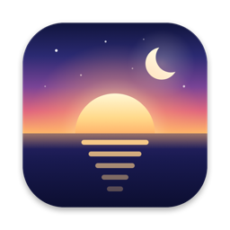
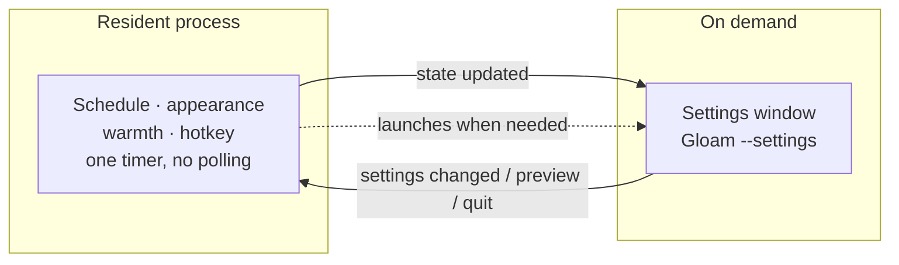

<div align="center">



# Gloam

**Automatic light / dark mode for macOS that stays out of your way — and out of your RAM.**

English · [简体中文](README.zh-CN.md)


</div>

<table>
  <tr>
    <td></td>
    <td><br><br></td>
  </tr>
</table>

Gloam switches your Mac between light and dark appearance at sunrise and sunset, can go dark early on gloomy days, warms the screen in the evening, and swaps the wallpaper to match. It does all of that from a background process that idles at **0% CPU, 0 wake-ups and as little as 4 MB of memory**.

> [!NOTE]
> The interface is currently in Simplified Chinese only. The screenshots above show the real UI.

## Features

- **Sunrise / sunset schedule** — computed on-device for any location and recalculated every day, with independent offsets of up to ±2 hours.
- **Custom times** — fixed switch times if you would rather not follow the sun.
- **Any time zone, without touching the system clock** — live on Beijing time while your Mac stays on Pacific time. Pick a city and its coordinates and time zone are filled in together.
- **Weather-aware dark mode** — if the forecast says the sky stays overcast until sunset, dark mode starts early. One decision per day, so the screen never flips back and forth.
- **Evening warmth** — colour temperature from 6500K down to 1900K with a 30-minute fade in and out, starting at sunset, at a set time, or all day. Night Shift is paused while it is active and handed back afterwards.
- **Wallpaper sync** — one wallpaper for light, one for dark, switched on every display.
- **Global hotkey** — `⌃⌥⌘D` by default, re-recordable.
- **Manual changes are respected** — toggle by hand and Gloam leaves it alone until the next scheduled switch.
- **Optional menu bar icon** — hide it and the resident process drops to single-digit megabytes.

## Footprint

Measured on macOS 27.2, Apple Silicon. All three shapes idle at 0% CPU with 0 wake-ups.

| Shape | Resident memory |
|---|---|
| Menu bar icon shown (default) | 12–14 MB |
| No icon, global hotkey kept | 7 MB |
| No icon, no hotkey | 4 MB |

The app bundle is about 1 MB, most of which is the icon.

### How it stays small



- **One timer, no polling.** Gloam works out the next moment anything needs to change, arms a single timer for it and goes back to sleep. Wake, display and clock changes arrive as notifications.
- **The settings window is a separate, short-lived process.** A preferences window costs roughly 40 MB of AppKit state that is never given back. Gloam opens it as `Gloam --settings`; closing the window ends that process and returns all of it.
- **No AppKit at all without the menu bar icon.** A status item needs `NSApplication`, whose floor is about 12 MB. With the icon hidden the resident process runs on a bare run loop instead.
- **Self-restart after the menu is used.** Opening an `NSMenu` once adds about 8 MB that stays. Thirty seconds after the menu closes, the process re-executes itself in place (same PID) and is back at its floor. This is skipped while evening warmth is active so the screen does not flicker.
- **Weather is fetched by `curl`.** One request a day through the system `curl`, so the resident process never loads the networking stack.

## Install

Gloam is built from source. You need the Xcode Command Line Tools (`xcode-select --install`); the build takes a few seconds.

```bash
git clone https://github.com/guangzhaoli/Gloam.git
cd Gloam
./build.sh
cp -R Gloam.app /Applications/
open /Applications/Gloam.app
```

On first launch the settings window opens so you can choose a city or use your current location.

## Usage

| | |
|---|---|
| **Open settings** | Launch Gloam again while it is running, or use the menu bar menu |
| **Toggle appearance** | `⌃⌥⌘D`, or the menu bar menu |
| **Lowest memory** | Settings → 通用 (General) → turn off 显示菜单栏图标 (Show menu bar icon) |
| **Quit** | Settings → 通用 (General) → 退出 Gloam, or the menu bar menu |

The settings window has five tabs:

| Tab | What it controls |
|---|---|
| 日程 Schedule | Sunrise / sunset, custom times or manual; location; offsets; time zone |
| 天气 Weather | Go dark early on overcast days; sensitivity; °C / °F |
| 暖色 Warmth | Evening colour temperature and when it starts |
| 壁纸 Wallpaper | Light and dark wallpapers |
| 通用 General | Hotkey, launch at login, menu bar icon |

Two diagnostic flags print to the terminal and exit:

```bash
/Applications/Gloam.app/Contents/MacOS/Gloam --status       # schedule, next switches, current state
/Applications/Gloam.app/Contents/MacOS/Gloam --permissions  # read-only permission report
```

## Privacy and permissions

- **Location** is the only permission Gloam ever asks for, and only when you press 定位 (Locate). Picking a city or typing coordinates needs no permission at all. The location is read once, rounded to about 1 km, and stored locally.
- **Sunrise and sunset** are calculated on your Mac.
- **Weather** is off by default. When enabled, Gloam sends your rounded coordinates to [Open-Meteo](https://open-meteo.com) once a day. Nothing else leaves your Mac.
- **Wallpapers** you choose are copied into Gloam's own folder, so no Files and Folders permission is needed.
- The hotkey does not need Accessibility or Input Monitoring.
- No analytics, no telemetry, no account.

## Caveats

- **Private APIs.** Switching appearance uses `SLSSetAppearanceThemeLegacy` from SkyLight (with an AppleScript fallback), and pausing Night Shift uses `CBBlueLightClient` from CoreBrightness. Both can break in a future macOS release, and they rule out the Mac App Store.
- **Evening warmth uses display gamma tables**, which the system resets on some wake and display changes. Gloam re-applies them, but a brief flash is possible.
- **Tested on macOS 27 on Apple Silicon only.** The deployment target is macOS 13 and nothing newer is required, but older releases and Intel Macs are untested.
- **The build is ad-hoc signed.** macOS treats every rebuild as a new app, so a granted location permission may be asked for again after you rebuild.
- **Wallpaper sync** applies to the current Space of each display and catches up when you switch Spaces.
- **Turn off the system's own Auto appearance**, or the two will fight.
- **Early project.** Scheduling, appearance switching, the hotkey, colour-temperature preview and the process hand-over are tested. Wallpaper sync, launch at login and the Night Shift hand-back have had little real-world use so far.

## Project layout

| File | Purpose |
|---|---|
| `main.swift` | Schedule maths, system interfaces, the resident process and the menu |
| `Settings.swift` | The settings process: window, tabs, location, hotkey recording |
| `makeicon.swift` | Draws the app icon with Core Graphics |
| `build.sh` | Compiles, bundles and ad-hoc signs `Gloam.app` |

Code comments are written in Chinese.

## Uninstall

Quit Gloam, then:

```bash
rm -rf /Applications/Gloam.app ~/Library/Application\ Support/Gloam
defaults delete local.gloam
```

## Acknowledgements

- Inspired by [Solace](https://theodorehq.com/solace). Gloam is an independent project and is not affiliated with it.
- Weather data by [Open-Meteo](https://open-meteo.com).
- Colour temperature conversion follows Tanner Helland's approximation; solar times use the standard sunrise equation.

## License

[MIT](LICENSE)
