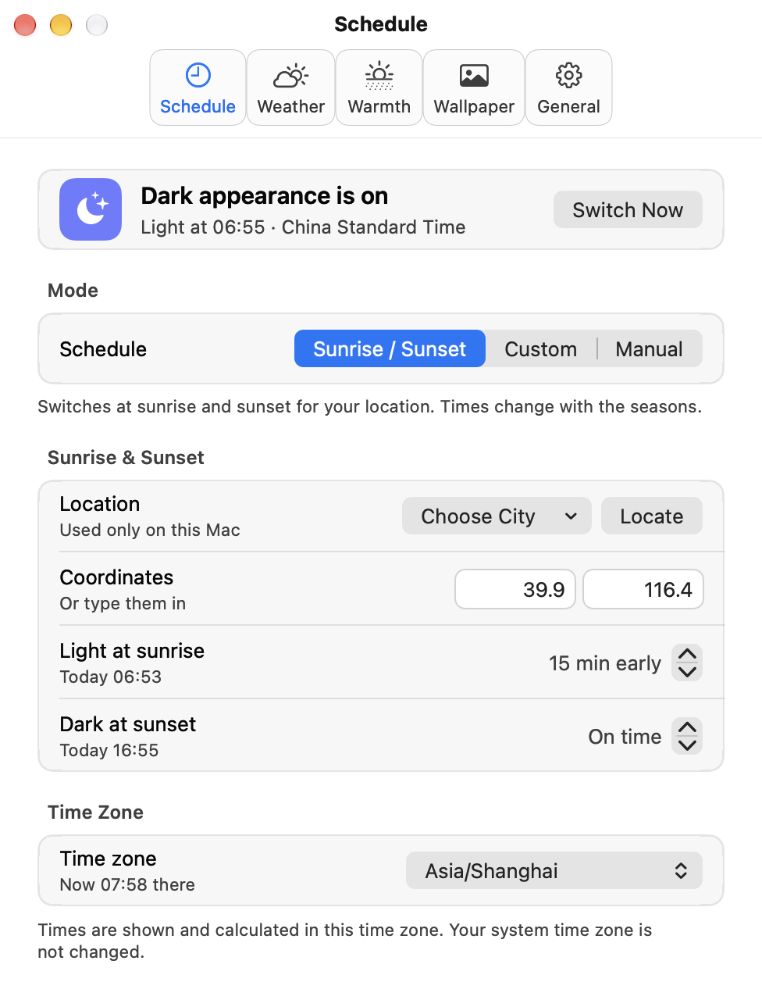
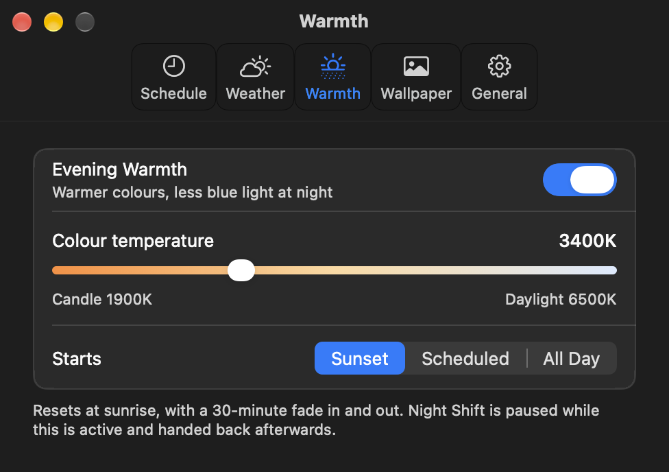
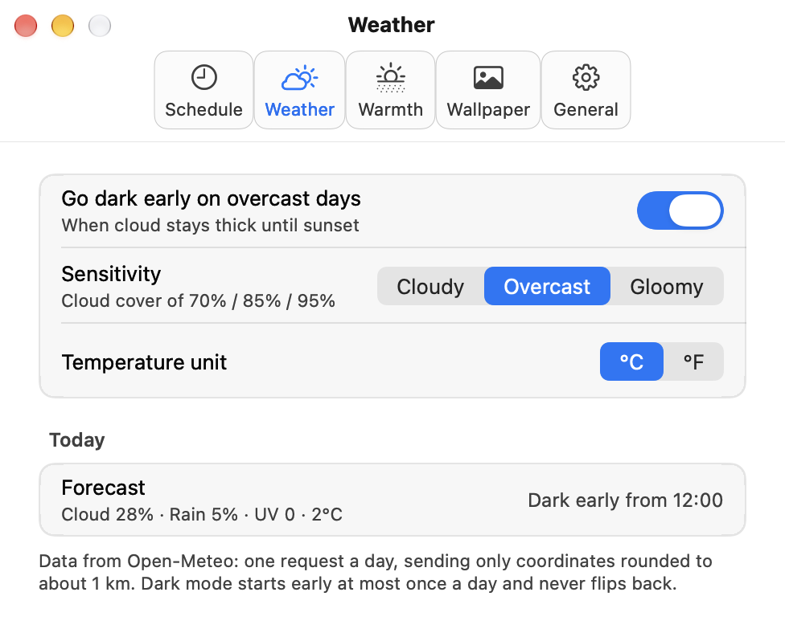

<div align="center">


# Gloam

**Automatic light and dark mode for macOS.**

English · [Chinese](README.zh-CN.md)


</div>

<table>
  <tr>
    <td></td>
    <td><br><br></td>
  </tr>
</table>

Gloam switches your Mac between light and dark appearance for you. It can follow the sun, follow fixed times you set, turn dark early when the day is gloomy, warm the screen in the evening, and change the wallpaper to match. It runs quietly in the background and sleeps until the next switch.

## What it does

### 1. Switches appearance on a schedule

Choose one of three modes in **Settings → Schedule**:

| Mode | What happens |
|---|---|
| **Sunrise / Sunset** | Light at sunrise, dark at sunset, for a location you choose. The times are recalculated every day, so they move with the seasons. You can shift each one up to 2 hours earlier or later. |
| **Custom** | Light and dark at two fixed times of your choice, the same every day. |
| **Manual** | Gloam never switches by itself. You switch with the hotkey or the menu. |

The top of the window always shows the current appearance and when the next switch will happen.

If you switch by hand, Gloam respects it: your choice stays until the next scheduled switch.

### 2. Works out sunrise and sunset for any place

Sunrise / Sunset mode needs a location. There are three ways to give it one:

- **Choose City** — pick from 24 major cities. The coordinates and the time zone are filled in together.
- **Locate** — ask macOS for your current location, once.
- **Coordinates** — type a latitude and longitude yourself.

The sun times are calculated on your Mac. Until a location is set, Gloam does not switch and tells you so.

### 3. Follows a time zone that is not your system's

Set **Time zone** to any zone and the whole schedule is shown and calculated there, without changing your Mac's clock. For example, your Mac can stay on Pacific time while appearance follows Beijing time.

### 4. Turns dark early on gloomy days

Turn on **Settings → Weather → Go dark early on overcast days**. Each day Gloam reads the forecast for your location. If the cloud cover stays above your chosen level all the way until sunset, dark mode starts at the hour the clouds roll in instead of waiting for sunset.

- **Sensitivity** sets how much cloud counts: Cloudy (70%), Overcast (85%) or Gloomy (95%). A thunderstorm always counts.
- The decision is made once a day, so the screen never flips back and forth.
- The Weather tab shows the current cloud, rain, UV and temperature reading, and whether today will switch early.

### 5. Warms the screen in the evening

Turn on **Settings → Warmth → Evening Warmth** to lower the screen's colour temperature at night.

- **Colour temperature** — anywhere from 6500K (daylight, no change) to 1900K (candlelight). 3400K is the default. Dragging the slider previews the result for a few seconds.
- **Starts** — at sunset, at a time you set, or all day.
- It fades in over 30 minutes, fades out before sunrise, and resets by itself.
- While it is active, Night Shift is paused so the two do not stack. Night Shift is handed back afterwards.

### 6. Changes the wallpaper with the appearance

In **Settings → Wallpaper**, choose one picture for light and one for dark. Gloam swaps them on every display whenever the appearance changes.

### 7. Toggles with a hotkey

Press `Control + Option + Command + D` in any app to flip between light and dark. You can record a different shortcut, or clear it, in **Settings → General**.

### 8. Stays out of the way

- **Menu bar icon** — shows a sun or a moon. Its menu has the current state, the next switch, a toggle, a quick switch for Evening Warmth, and Settings.
- **Hide the icon** if you prefer a clean menu bar. Gloam keeps working; open Gloam again to reach Settings.
- **Launch at login** is available in **Settings → General**.
- **Language** — the interface is English by default, with Chinese available in **Settings → General**.

## Install

Gloam is built from source. You need the Xcode Command Line Tools (`xcode-select --install`). The build takes a few seconds.

```bash
git clone https://github.com/guangzhaoli/Gloam.git
cd Gloam
./build.sh
cp -R Gloam.app /Applications/
open /Applications/Gloam.app
```

## Getting started

1. Open Gloam. The first time, the Settings window opens by itself.
2. In **Schedule**, click **Choose City**, or **Locate**, to set where you are.
3. That is all. Gloam now switches at sunrise and sunset.

| To do this | Do this |
|---|---|
| Open Settings | Open Gloam again while it is running, or use the menu bar menu |
| Switch appearance now | Press the hotkey, or use the menu bar menu |
| Quit | **Settings → General → Quit Gloam**, or the menu bar menu |

Two commands print a report in the terminal and exit:

```bash
/Applications/Gloam.app/Contents/MacOS/Gloam --status       # the schedule and the current state
/Applications/Gloam.app/Contents/MacOS/Gloam --permissions  # a read-only permission report
```

## Privacy and permissions

- **Location** is the only permission Gloam ever asks for, and only when you press **Locate**. Choosing a city or typing coordinates needs no permission. The location is read once, rounded to about 1 km, and kept on your Mac.
- **Weather** is off by default. When it is on, Gloam sends your rounded coordinates to [Open-Meteo](https://open-meteo.com) once a day. Nothing else leaves your Mac.
- **Wallpapers** you choose are copied into Gloam's own folder, so no Files and Folders permission is needed.
- The hotkey does not need Accessibility or Input Monitoring.
- No analytics, no telemetry, no account.

## Good to know

- **Turn off the system's own Auto appearance** in System Settings, or the two will fight.
- **Private APIs.** Switching appearance uses `SLSSetAppearanceThemeLegacy` from SkyLight, with an AppleScript fallback. Pausing Night Shift uses `CBBlueLightClient` from CoreBrightness. Both could break in a future macOS release, and they rule out the Mac App Store.
- **Evening Warmth uses display gamma tables.** macOS resets them on some wake and display changes. Gloam applies them again, but a brief flash is possible.
- **Tested on macOS 27 on Apple Silicon only.** The deployment target is macOS 13, but older releases and Intel Macs are untested.
- **The build is ad-hoc signed.** macOS treats every rebuild as a new app, so a granted location permission may be asked for again after you rebuild.
- **Wallpaper** changes apply to the current Space of each display and catch up when you switch Spaces.
- **Early project.** Scheduling, appearance switching, the hotkey, the colour temperature preview and language switching are tested. Wallpaper sync, launch at login and the Night Shift hand-back have had little real-world use so far.

## Project layout

| File | Purpose |
|---|---|
| `main.swift` | Schedule maths, system interfaces, the background process and the menu |
| `Settings.swift` | The Settings window: tabs, location, hotkey recording |
| `makeicon.swift` | Draws the app icon with Core Graphics |
| `build.sh` | Compiles, bundles and ad-hoc signs `Gloam.app` |

Code comments are written in Chinese.

## Uninstall

Quit Gloam, then:

```bash
rm -rf /Applications/Gloam.app ~/Library/Application\ Support/Gloam
defaults delete local.gloam
```

## Acknowledgements

- Inspired by [Solace](https://theodorehq.com/solace). Gloam is an independent project and is not affiliated with it.
- Weather data by [Open-Meteo](https://open-meteo.com).
- Colour temperature conversion follows Tanner Helland's approximation. Solar times use the standard sunrise equation.

## License

[MIT](LICENSE)
