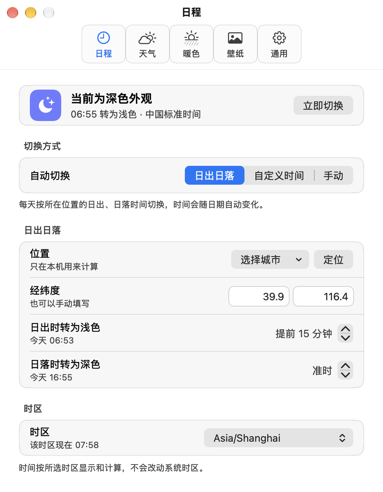
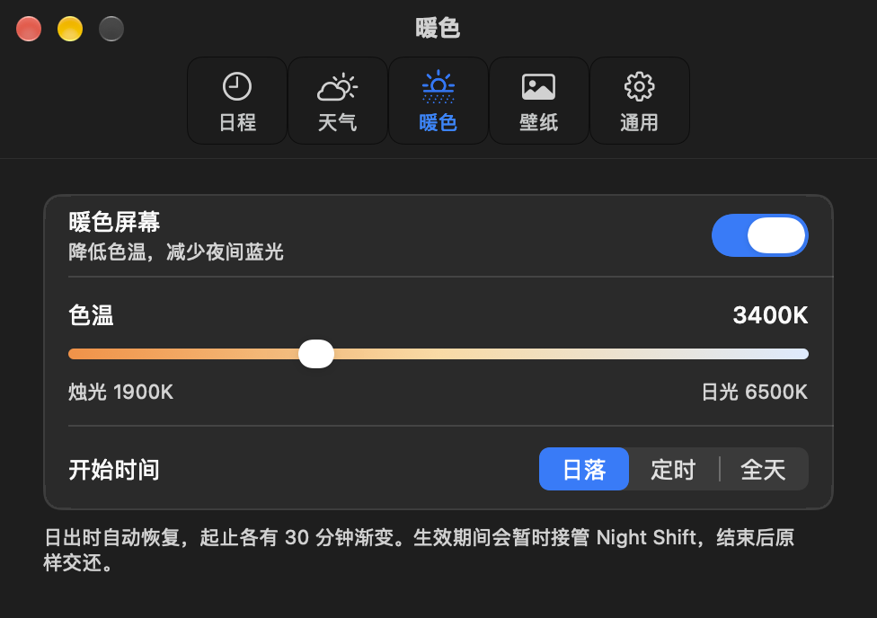
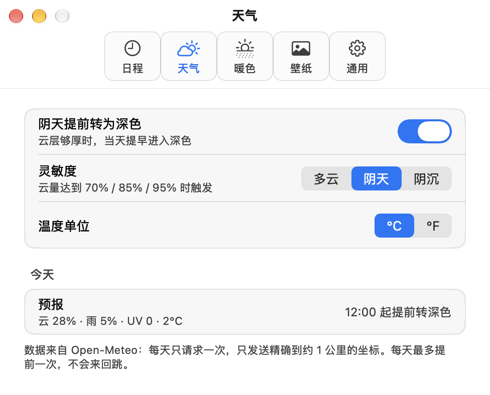

<div align="center">


# Gloam

**macOS 自动深浅色切换工具。**

[English](README.md) · 简体中文


</div>

<table>
  <tr>
    <td></td>
    <td><br><br></td>
  </tr>
</table>

Gloam 替你在浅色和深色外观之间切换。它可以跟着太阳走，也可以按你定的固定时间走；阴沉的日子提前转深色，晚上给屏幕加暖色，并让壁纸跟着外观一起换。它在后台安静运行，一直休眠到下一次切换。

## 它能做什么

### 1. 按日程切换外观

在 **设置 → 日程** 里选择三种方式之一：

| 方式 | 效果 |
|---|---|
| **日出日落** | 按你选的位置，日出时转浅色，日落时转深色。时间每天重新计算，所以会随季节变化。两个时间各自可以提前或延后最多 2 小时。 |
| **自定义时间** | 在你设定的两个固定时间转浅色和转深色，每天相同。 |
| **手动** | Gloam 不会自己切换，只在你按快捷键或点菜单时切换。 |

窗口顶部始终显示当前外观，以及下一次切换的时间。

如果你手动切换过，Gloam 会尊重你的选择：在下一个日程切换点之前不会改回去。

### 2. 为任意地点计算日出日落

「日出日落」方式需要一个位置，有三种设置办法：

- **选择城市**：从 24 个主要城市里选，坐标和时区会一起填好。
- **定位**：向 macOS 请求一次你当前的位置。
- **经纬度**：自己填写纬度和经度。

日出日落时间在本机计算。在设置位置之前，Gloam 不会切换，并且会明确告诉你原因。

### 3. 按系统以外的时区运行

把 **时区** 设成任意时区，整个日程就按那个时区显示和计算，不会改动 Mac 的系统时钟。比如 Mac 留在美西时间，外观却跟着北京时间走。

### 4. 阴沉的日子提前转深色

打开 **设置 → 天气 → 阴天提前转为深色**。Gloam 每天读取你所在位置的预报：如果云量一直高于你选的档位直到日落，深色就从云层变厚的那个整点开始，而不是等到日落。

- **灵敏度**决定多厚的云才算：多云（70%）、阴天（85%）、阴沉（95%）。雷暴一律算。
- 每天只决定一次，屏幕不会来回跳。
- 天气页会显示当前的云量、降雨概率、紫外线和温度，以及今天会不会提前切换。

### 5. 晚上给屏幕加暖色

打开 **设置 → 暖色 → 暖色屏幕**，在夜间降低屏幕色温。

- **色温**：从 6500K（日光，无变化）到 1900K（烛光）任意调节，默认 3400K。拖动滑块时会实时预览几秒。
- **开始时间**：日落时、你指定的时间，或者全天。
- 开始时用 30 分钟渐入，日出前渐出，然后自动恢复。
- 生效期间会暂停 Night Shift，避免两者叠加；结束后原样交还。

### 6. 壁纸跟着外观换

在 **设置 → 壁纸** 里为浅色和深色各选一张图片。外观变化时，Gloam 会在所有显示器上一起更换。

### 7. 用快捷键切换

在任何应用里按 `Control + Option + Command + D`，就能在浅色和深色之间切换。可以在 **设置 → 通用** 里录制别的组合键，或者清除它。

### 8. 不打扰你

- **菜单栏图标**：显示太阳或月亮。菜单里有当前状态、下一次切换时间、切换按钮、暖色屏幕的快速开关，以及设置入口。
- **可以隐藏图标**，保持菜单栏干净。Gloam 照常工作；再次打开 Gloam 就能进入设置。
- **登录时启动**在 **设置 → 通用** 里。
- **语言**：界面默认是英文，可以在 **设置 → 通用** 里切换成中文。

## 安装

Gloam 需要从源码构建。只需要 Xcode 命令行工具（`xcode-select --install`），构建只要几秒。

```bash
git clone https://github.com/guangzhaoli/Gloam.git
cd Gloam
./build.sh
cp -R Gloam.app /Applications/
open /Applications/Gloam.app
```

## 开始使用

1. 打开 Gloam。第一次会自动弹出设置窗口。
2. 想用中文界面，先到 **General → Language** 选「中文」。
3. 在 **日程** 里点 **选择城市** 或 **定位**，设置你所在的位置。
4. 完成。之后 Gloam 会在日出日落时自动切换。

| 想做什么 | 怎么做 |
|---|---|
| 打开设置 | 在 Gloam 运行时再次打开它，或者用菜单栏菜单 |
| 立即切换外观 | 按快捷键，或者用菜单栏菜单 |
| 退出 | **设置 → 通用 → 退出 Gloam**，或者用菜单栏菜单 |

两个命令会在终端里打印报告后退出：

```bash
/Applications/Gloam.app/Contents/MacOS/Gloam --status       # 日程和当前状态
/Applications/Gloam.app/Contents/MacOS/Gloam --permissions  # 只读的权限状态报告
```

## 隐私与权限

- **定位**是 Gloam 唯一会申请的权限，而且只在你点 **定位** 时才申请。选城市或手动填经纬度不需要任何权限。位置只读取一次，精确到约 1 公里，保存在本机。
- **天气**默认关闭。开启后，Gloam 每天把取整后的坐标发给 [Open-Meteo](https://open-meteo.com) 一次。除此之外没有任何数据离开你的 Mac。
- 你选的**壁纸**会复制到 Gloam 自己的目录，所以不需要「文件与文件夹」权限。
- 快捷键不需要辅助功能或输入监控权限。
- 没有统计，没有遥测，不需要账号。

## 须知

- **请在系统设置里关闭系统自带的「自动」外观**，否则两者会互相覆盖。
- **使用了私有接口。** 切换外观用的是 SkyLight 的 `SLSSetAppearanceThemeLegacy`，带 AppleScript 兜底；暂停 Night Shift 用的是 CoreBrightness 的 `CBBlueLightClient`。它们可能在以后的 macOS 版本里失效，也意味着无法上架 Mac App Store。
- **暖色通过显示器 gamma 表实现。** macOS 在某些唤醒和显示器变化时会重置它。Gloam 会重新应用，但可能短暂闪一下。
- **只在 macOS 27、Apple Silicon 上测试过。** 最低部署目标是 macOS 13，但旧系统和 Intel Mac 未经测试。
- **构建产物是临时签名。** 每次重新构建，系统都把它当成新应用，已经给过的定位授权可能会再问一次。
- **壁纸**更换作用于每个显示器当前的桌面空间，切换空间时会补上。
- **项目还很新。** 日程、外观切换、快捷键、色温预览、语言切换都经过测试；壁纸同步、登录时启动、Night Shift 交还目前实际使用得还很少。

## 项目结构

| 文件 | 作用 |
|---|---|
| `main.swift` | 日程计算、系统接口、后台进程和菜单 |
| `Settings.swift` | 设置窗口：分页、定位、快捷键录制 |
| `makeicon.swift` | 用 Core Graphics 绘制应用图标 |
| `build.sh` | 编译、打包并临时签名 `Gloam.app` |

## 卸载

先退出 Gloam，然后：

```bash
rm -rf /Applications/Gloam.app ~/Library/Application\ Support/Gloam
defaults delete local.gloam
```

## 致谢

- 灵感来自 [Solace](https://theodorehq.com/solace)。Gloam 是独立项目，与它没有关联。
- 天气数据来自 [Open-Meteo](https://open-meteo.com)。
- 色温换算采用 Tanner Helland 的近似公式；日出日落时间采用标准的日出方程。

## 许可证

[MIT](LICENSE)
