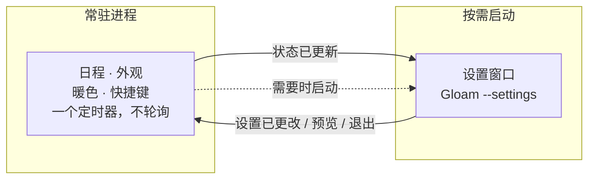

<div align="center">


# Gloam

**macOS 自动深浅色切换工具：不打扰你，也几乎不占内存。**

[English](README.md) · 简体中文


</div>

<table>
  <tr>
    <td></td>
    <td><br><br></td>
  </tr>
</table>

Gloam 在日出日落时自动切换 Mac 的浅色和深色外观，阴天可以提前转深色，晚上给屏幕加暖色，并让壁纸跟着外观一起换。这一切由一个后台进程完成，空闲时 **CPU 0%、唤醒 0 次，内存最低只要 4 MB**。

## 功能

- **日出日落日程**：在本机按任意位置计算，每天重新算，日出和日落各自可以偏移 ±2 小时。
- **自定义时间**：不想跟着太阳走，就用固定钟点。
- **任意时区，不动系统时钟**：系统留在美西时间，日程按北京时间走。选一个城市，坐标和时区会一起填好。
- **天气感知**：预报显示云层会一直厚到日落，就提前进入深色。每天只决定一次，屏幕不会来回跳。
- **暖色屏幕**：色温从 6500K 到 1900K，起止各有 30 分钟渐变，可以从日落、指定时间开始，或者全天开启。生效期间暂时接管 Night Shift，结束后原样交还。
- **壁纸同步**：浅色、深色各一张，所有显示器一起换。
- **全局快捷键**：默认 `⌃⌥⌘D`，可以重新录制。
- **尊重手动切换**：手动切过之后，Gloam 在下一个切换点之前不会改回去。
- **菜单栏图标可选**：关掉图标后，常驻进程只占个位数 MB。

## 占用

在 macOS 27.2、Apple Silicon 上实测。三种形态空闲时都是 CPU 0%、唤醒 0 次。

| 形态 | 常驻内存 |
|---|---|
| 显示菜单栏图标（默认） | 12–14 MB |
| 不显示图标，保留全局快捷键 | 7 MB |
| 不显示图标，也不要快捷键 | 4 MB |

应用本身约 1 MB，其中大部分是图标。

### 为什么能这么小



- **一个定时器，不轮询。** Gloam 算出下一个需要变化的时刻，挂一个定时器就继续休眠。唤醒、显示器变化、时钟变化都靠系统通知。
- **设置窗口是独立的短命进程。** 一个设置窗口会让界面框架多占约 40 MB，而且不会归还。Gloam 用 `Gloam --settings` 单独启动它，关窗即退出，内存全部还给系统。
- **不显示图标时完全不启动 AppKit。** 菜单栏图标需要 `NSApplication`，它的下限约 12 MB。隐藏图标后，常驻进程只跑一个最普通的事件循环。
- **用过菜单后自己重启。** `NSMenu` 弹出一次会多占约 8 MB 且不归还。菜单关闭 30 秒后，进程原地重新执行自己（进程号不变），回到下限。暖色生效期间不重启，免得屏幕闪一下。
- **天气用 `curl` 去取。** 每天一次请求，交给系统自带的 `curl`，常驻进程不加载联网框架。

## 安装

Gloam 需要从源码构建。只需要 Xcode 命令行工具（`xcode-select --install`），构建只要几秒。

```bash
git clone https://github.com/guangzhaoli/Gloam.git
cd Gloam
./build.sh
cp -R Gloam.app /Applications/
open /Applications/Gloam.app
```

第一次启动会打开设置窗口，让你选一个城市或使用当前位置。

## 使用

| | |
|---|---|
| **打开设置** | 在 Gloam 运行时再次打开它，或者用菜单栏菜单 |
| **切换外观** | `⌃⌥⌘D`，或者菜单栏菜单 |
| **最低内存** | 设置 → 通用 → 关闭「显示菜单栏图标」 |
| **退出** | 设置 → 通用 →「退出 Gloam」，或者菜单栏菜单 |

设置窗口有五个分页：

| 分页 | 内容 |
|---|---|
| 日程 | 日出日落、自定义时间或手动；位置；偏移；时区 |
| 天气 | 阴天提前转深色；灵敏度；°C / °F |
| 暖色 | 晚间色温和开始时间 |
| 壁纸 | 浅色和深色壁纸 |
| 通用 | 快捷键、登录时启动、菜单栏图标 |

两个诊断命令，打印结果后退出：

```bash
/Applications/Gloam.app/Contents/MacOS/Gloam --status       # 日程、接下来的切换点、当前状态
/Applications/Gloam.app/Contents/MacOS/Gloam --permissions  # 只读的权限状态报告
```

## 隐私与权限

- **定位**是 Gloam 唯一会申请的权限，而且只在你点「定位」时才申请。选城市或手动填经纬度不需要任何权限。位置只读取一次，精确到约 1 公里，保存在本机。
- **日出日落**在本机计算。
- **天气**默认关闭。开启后，Gloam 每天把取整后的坐标发给 [Open-Meteo](https://open-meteo.com) 一次。除此之外没有任何数据离开你的 Mac。
- 你选的**壁纸**会复制到 Gloam 自己的目录，所以不需要「文件与文件夹」权限。
- 快捷键不需要辅助功能或输入监控权限。
- 没有统计，没有遥测，不需要账号。

## 注意事项

- **使用了私有接口。** 切换外观用的是 SkyLight 的 `SLSSetAppearanceThemeLegacy`（带 AppleScript 兜底），暂停 Night Shift 用的是 CoreBrightness 的 `CBBlueLightClient`。它们可能在以后的 macOS 版本里失效，也意味着无法上架 Mac App Store。
- **暖色通过显示器 gamma 表实现**，系统在某些唤醒和显示器变化时会重置它。Gloam 会重新应用，但可能短暂闪一下。
- **只在 macOS 27、Apple Silicon 上测试过。** 最低部署目标是 macOS 13，没有用到更新的接口，但旧系统和 Intel Mac 未经测试。
- **构建产物是临时签名。** 每次重新构建，系统都把它当成新应用，已经给过的定位授权可能会再问一次。
- **壁纸同步**作用于每个显示器当前的桌面空间，切换空间时会补上。
- **请关闭系统自带的「自动」外观**，否则两者会互相覆盖。
- **项目还很新。** 日程、外观切换、快捷键、色温预览、进程交接都经过测试；壁纸同步、登录时启动、Night Shift 交还目前实际使用得还很少。

## 项目结构

| 文件 | 作用 |
|---|---|
| `main.swift` | 日程计算、系统接口、常驻进程和菜单 |
| `Settings.swift` | 设置进程：窗口、分页、定位、快捷键录制 |
| `makeicon.swift` | 用 Core Graphics 绘制应用图标 |
| `build.sh` | 编译、打包并临时签名 `Gloam.app` |

## 卸载

先退出 Gloam，然后：

```bash
rm -rf /Applications/Gloam.app ~/Library/Application\ Support/Gloam
defaults delete local.gloam
```

## 致谢

- 灵感来自 [Solace](https://theodorehq.com/solace)。Gloam 是独立项目，与它没有关联。
- 天气数据来自 [Open-Meteo](https://open-meteo.com)。
- 色温换算采用 Tanner Helland 的近似公式；日出日落时间采用标准的日出方程。

## 许可证

[MIT](LICENSE)
